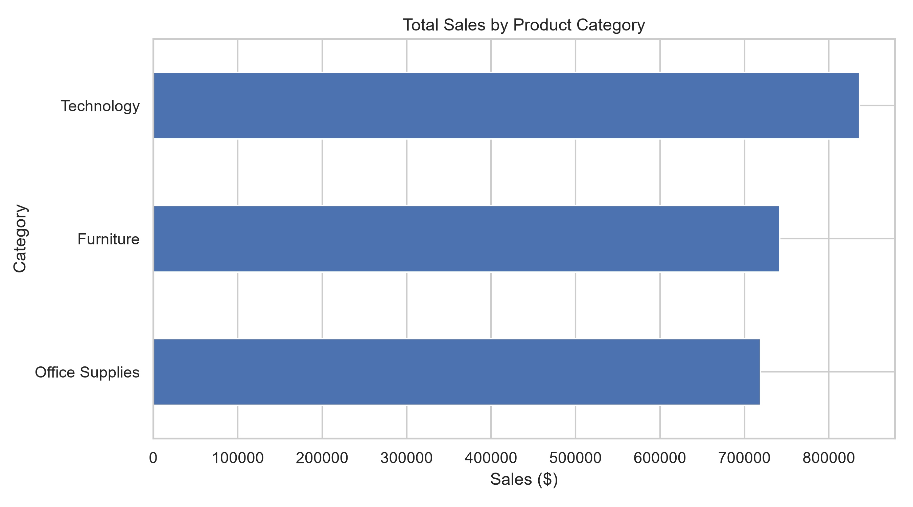
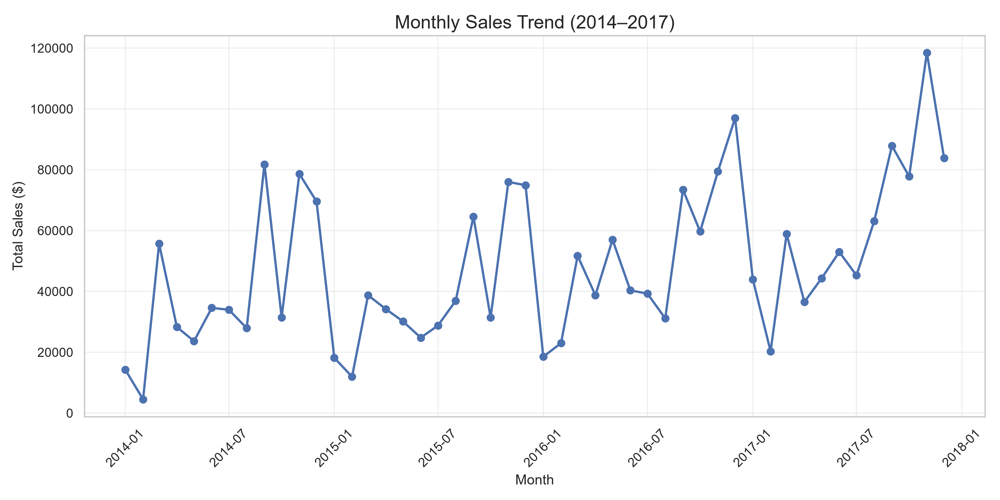
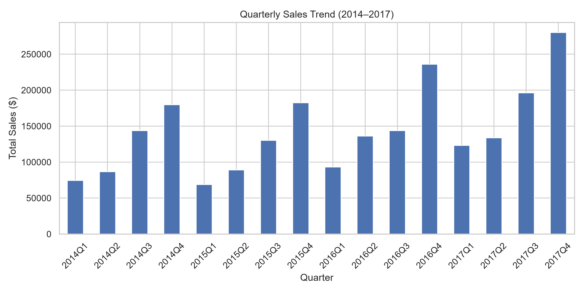
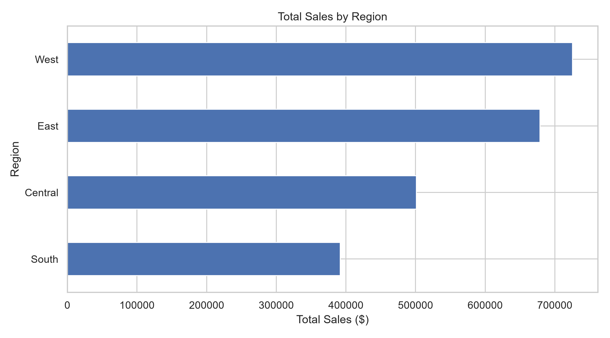
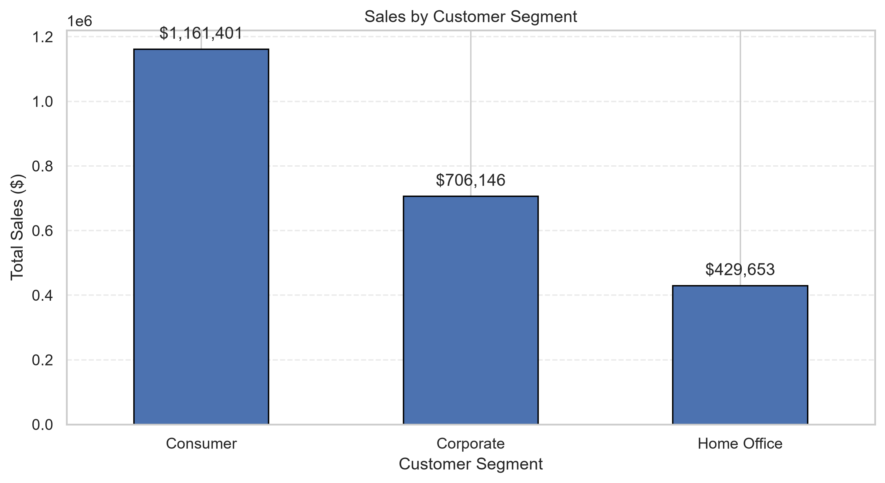
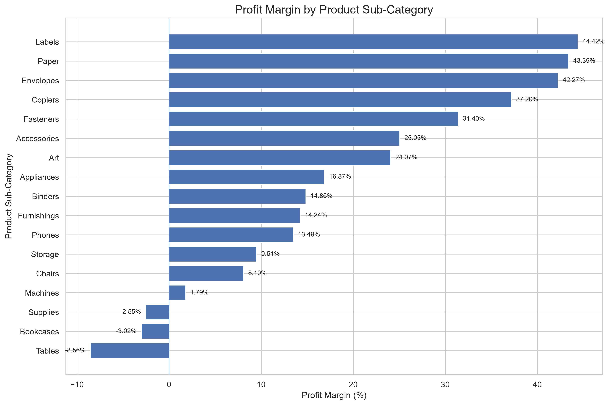

# CodeNova Internship — Sales Data Analysis

## Project Overview
This project performs exploratory data analysis (EDA) on the Sample Superstore retail dataset to understand sales performance, profitability, product demand, seasonal patterns, and regional trends.

## Tools Used
- Python
- Pandas and NumPy
- Matplotlib and Seaborn
- Visual Studio Code and Jupyter Notebook

## Dataset
The dataset contains 9,994 records and 22 columns, including order dates, customer segments, regions, product categories, sales, quantities, discounts, and profits.

## Key Performance Indicators

| Metric | Result |
|---|---:|
| Total Sales | $2,297,200.86 |
| Total Profit | $286,397.02 |
| Units Sold | 37,873 |
| Overall Profit Margin | 12.47% |
| Unique Orders | 5,009 |
| Average Order Value | $458.61 |

## Analysis Performed
- Overall sales, profit, units sold, and profit margin
- Monthly and quarterly sales trends
- Category-wise sales and profitability
- Regional sales distribution
- Customer segment-wise sales, profit, order count, and profit margin
- Sub-category performance
- Seasonal sales patterns
- Top 10 products by total sales
- Average Order Value (AOV)

## Key Findings
1. **Technology** generated the highest category sales, approximately $836,154.
2. **Office Supplies** recorded the highest unit volume, with 22,906 units sold.
3. **Furniture** generated approximately $18,451 in profit despite sales of around $742,000.
4. **Tables** and **Bookcases** recorded negative total profits, indicating areas that need further investigation.
5. The **West** region had the highest sales, approximately $725,458.
6. The Canon imageCLASS 2200 Advanced Copier was the highest-selling product by revenue, generating approximately $61,600.
7. **Technology** achieved the highest category profit margin at 17.40%, followed by Office Supplies at 17.04%.
8. **Furniture** had the lowest category profit margin at 2.49%, highlighting a need for profitability improvement.
9. **Labels** recorded the highest sub-category profit margin at 44.42%, followed by Paper at 43.39% and Envelopes at 42.27%.
10. **Tables** had the lowest sub-category profit margin at -8.56%, followed by Bookcases at -3.02% and Supplies at -2.55%.
11. High profit margin does not necessarily mean high total profit; both metrics should be considered when prioritizing products.

## Strategic Recommendations
- Review discounts, pricing, shipping costs, and product costs for loss-making sub-categories.
- Prioritize high-performing Technology products while monitoring profitability.
- Investigate the West region's successful sales patterns for potential application elsewhere.
- Use monthly and quarterly trends to support inventory and promotional planning.
- Evaluate both revenue and profit margin before prioritizing products for future campaigns.

## Charts Generated
- `category_sales.png`
- `category_profit.png`
- `monthly_sales_trend.png`
- `quarterly_sales.png`
- `region_sales.png`
- `subcategory_sales.png`
- `seasonal_sales.png`
- `top_10_products.png`
- subcategory_profit_margin.png
- segment_sales.png

## Project Visualizations

### Category Sales

### Monthly Sales Trend

### Quarterly Sales

### Regional Sales

### Customer Segment Sales

### Subcategory Profit Margin

## Validation and Limitations

- Dataset contains 9,994 records and 22 columns.
- Missing values and duplicate records were checked.
- Total sales and profit were validated against category-wise and regional aggregations.
- Customer demographic details such as age and gender are not available in the dataset, so the analysis focuses on customer segments and geographic distribution.
- The findings describe historical data and do not guarantee future performance.

## Conclusion
The analysis identifies key revenue drivers, regional differences, and loss-making product lines. These findings can help stakeholders improve pricing decisions, profitability monitoring, and sales planning.
